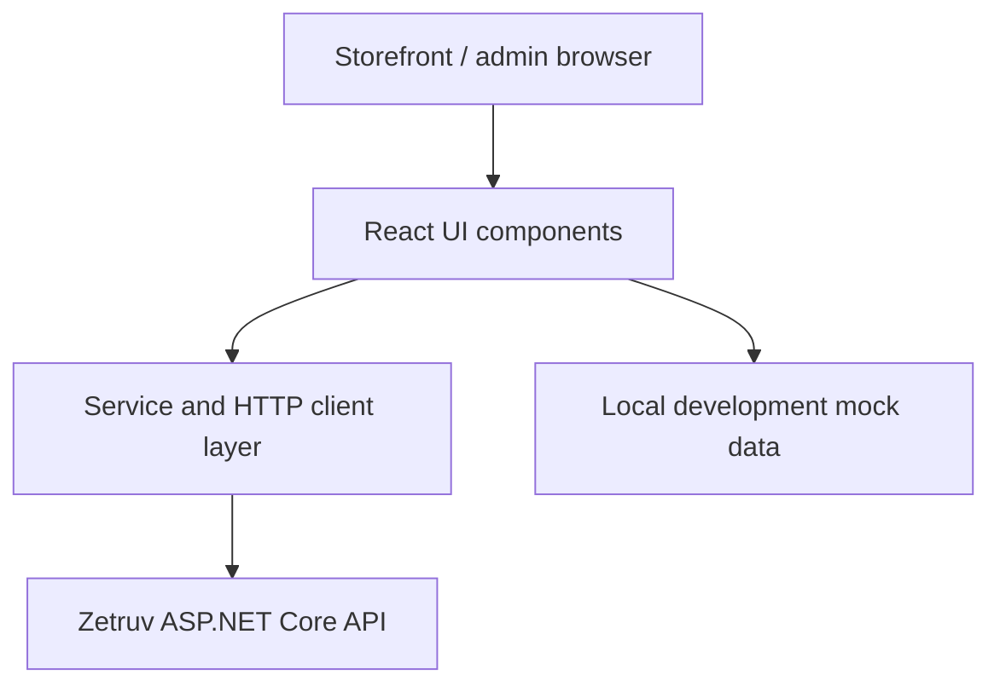

# Zetruv Frontend

**React + Vite storefront and admin UI** for the Zetruv e-commerce project.
This repository complements the [ASP.NET Core backend](https://github.com/karkandea/zetruv-backend)
and demonstrates the frontend/API boundary of the same product.

**Status:** Active development. This README describes the checked-in default
branch; experimental routes, integrations, or designs on other branches are
not assumed to be merged or production-ready.

## At a glance

| Concern | Implementation |
| --- | --- |
| Framework | React, Vite, JavaScript, plain CSS |
| UI | Storefront pages, reusable components, responsive layout, separate admin entry |
| Integration | Native `fetch` through an HTTP client and endpoint-specific services |
| Data | Backend homepage adapter; local mock data for development work |
| Builds | Distinct storefront and admin Vite configurations |

## Implemented experience

The default branch contains homepage sections, product discovery/search,
product detail variations, a leaderboard view, navigation, and a floating
support form. The admin entry lives in `src/admin` with its own Vite build.
The app's current route switch is in [`src/App.jsx`](src/App.jsx).



The application is not described as a complete checkout/payment integration
solely because a backend endpoint exists. Backend capabilities and actual UI
connections should be assessed separately.

## Local setup

Requires a supported Node.js installation and npm.

```bash
npm install
cp .env.example .env
npm run dev
```

Other build commands (see [`package.json`](package.json)):

```bash
npm run build:storefront
npm run build:admin
npm run build:all:dev
```

For local frontend-only development, leaving `VITE_API_BASE_URL` empty keeps
the mock-data workflow. Production builds default to the same-origin `/api/v1`
API; if that backend fails, production does not silently pretend mock data is
live. Configure `VITE_API_BASE_URL` only for an intentionally separate API
origin. Do not put credentials in `VITE_` variables: they are bundled into
client-side JavaScript.

## Key design decisions

- **API adapter boundary:** `src/api/httpClient.js` and `src/services/` map
  API responses into UI-facing models instead of coupling every component to
  raw transport details.
- **Separate admin build:** `vite.admin.config.js` creates a distinct admin
  entry point while retaining a shared repository.
- **Explicit mock versus live behavior:** mock content is for local design
  workflows, not a production fallback.
- **Figma asset migration:** remote export URLs may expire; enduring assets
  should be stored locally in `public/assets` before handoff.

## Verification and limitations

The repository's [`package.json`](package.json) defines Vite build scripts
but **no unit-test or test-runner script** on this default-branch snapshot.
It also has no tracked npm lockfile on this branch, so dependency resolution
is not deterministic; adding and reviewing a lockfile is a separate CI/hygiene
task.
The checked-in [frontend workflow](.github/workflows/deploy-frontend.yml) is
a deployment workflow for `dev` and `main`, not a standalone PR build gate.
On **2026-10-27**, local `npm run build:storefront` and
`npm run build:admin` both succeeded after an npm dependency install (Vite
8.3.5 resolved at that time). Without a lockfile, a future install may resolve
different versions; these builds are not an end-to-end browser test.

The support form expects `POST /support/reports`, which is not implemented by
the current backend API; live submission may fail. UI integrations and
production assets require route-by-route QA rather than assuming the complete
design has been implemented.

Contributions and ownership of individual features should be checked against
the commit and pull-request history; this document does not assert sole
authorship.
