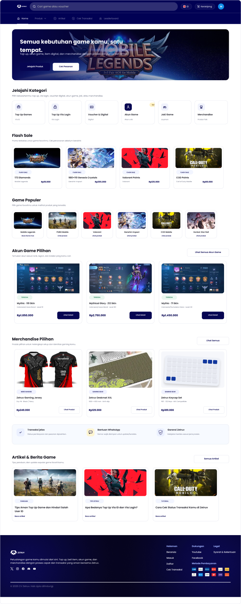
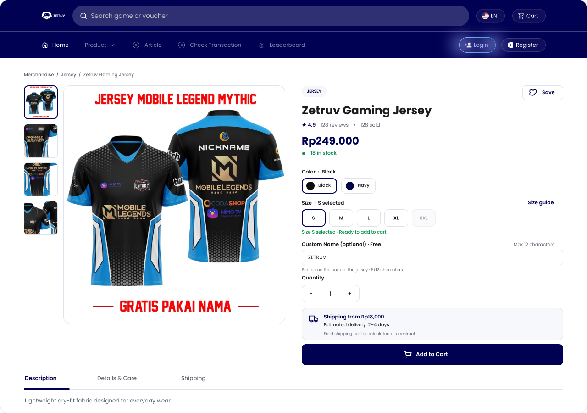

# Zetruv — Screenshot-first Figma Handoff (16 Oct 2026)

**Direktori ini adalah paket PNG referensi visual untuk FE developer.** Semua gambar di \`screenshots/\` diekspor dari layar/frame desain, bukan gambar DEV yang sedang berjalan. Tidak ada kebutuhan membuka Figma; gunakan PNG berikut langsung. File ini **bukan** bukti FE sudah 1:1.

**Mulai dari:** [DEV BRIEF](./FE_DEV_BRIEF.md) · [Daftar screenshot](./screenshots/) · [Audit sebelumnya](./AUDIT_FINDINGS.md).

## Source of truth
- Homepage: **01** final client review 1280px (jangan pakai homepage archive/exploration).
- Screen UX: auth, Digital Purchase, Physical Purchase, Status Order, Akun Saya, Artikel.
- Responsive: 390px marketplace + physical mobile screenshots. 
- Admin CMS: file **50–53** *separate phase*; jangan dicampur dengan storefront.
- Screenshot Figma berisi *sample text/order values* untuk menjelaskan desain **bukan data valid untuk ditampilkan di DEV**.

### Homepage final (desktop)

### Merchandise PDP approved

## Index screenshot
| Kelompok | File (klik untuk buka PNG) | Route/layout FE utama |
| --- | --- | --- |
| Homepage final | [01](./screenshots/01-homepage-final.png), [44 Mobile](./screenshots/44-mobile-homepage.png) | \`/\` |
| Login & Register | [02 Login](./screenshots/02-auth-login.png), [03 Register](./screenshots/03-auth-register.png), [07 Verification](./screenshots/07-auth-register-verify-email.png), [48 Expired](./screenshots/48-auth-register-link-expired.png) | navbar auth modal |
| Forgot Password | [04 Request](./screenshots/04-auth-forgot-request.png), [05 Email sent](./screenshots/05-auth-forgot-check-email.png), [06 New password](./screenshots/06-auth-forgot-new-password.png), [47 Success](./screenshots/47-auth-forgot-success.png) | navbar modal / reset URL |
| Top Up Via ID | [08 Detail](./screenshots/08-digital-via-id-product.png), [09 Cart](./screenshots/09-digital-via-id-cart.png), [10 Checkout](./screenshots/10-digital-via-id-checkout.png), [11 Payment](./screenshots/11-digital-via-id-payment.png), [12 Order](./screenshots/12-digital-via-id-order-detail.png) | \`/product/*\`, \`/cart\`, \`/checkout\`, \`/payment\` |
| Via Login | [13 Detail](./screenshots/13-digital-via-login-product.png), [14 Checkout](./screenshots/14-digital-via-login-checkout.png) | \`/product/*/login\`, \`/checkout\` |
| Voucher, Joki, Akun Game | [15 Voucher Detail](./screenshots/15-digital-voucher-product.png), [17 Voucher Delivered](./screenshots/17-digital-voucher-delivered.png), [18 Joki Detail](./screenshots/18-digital-joki-product.png), [19 Akun Game Detail](./screenshots/19-digital-game-account-detail.png) | \`/product/voucher/*\`, \`/product/joki/*\`, \`/game-accounts/*\` |
| Physical desktop | [20 Listing](./screenshots/20-physical-listing.png), [21 PDP](./screenshots/21-physical-product-approved.png), [22 Cart](./screenshots/22-physical-cart.png), [23 Checkout](./screenshots/23-physical-checkout.png), [24 Payment pending](./screenshots/24-physical-payment-pending.png), [25 Tracking](./screenshots/25-physical-tracking.png), [26 Delivered/review](./screenshots/26-physical-delivered-review.png) | \`/merchandise\`, \`/merchandise/:slug\`, \`/cart?flow=physical\`, etc. |
| Physical mobile | [27 Listing 390](./screenshots/27-physical-mobile-listing.png), [28 PDP 390](./screenshots/28-physical-mobile-pdp.png) | responsive /merchandise |
| Order states | [29 History](./screenshots/29-status-order-history.png), [30 Processing](./screenshots/30-status-order-processing.png), [31 Invoice](./screenshots/31-status-invoice.png), [32 Completed](./screenshots/32-status-completed.png), [33 Action needed](./screenshots/33-status-action-needed.png), [34 Shipping](./screenshots/34-status-merchandise-tracking.png), [49 Failed/refund](./screenshots/49-status-failed-cancelled-refunded.png) | \`/order-status\`, \`/account/orders/:id\` |
| Account | [35 Overview](./screenshots/35-account-overview.png), [36 Orders filled](./screenshots/36-account-orders-filled.png), [37 Orders empty](./screenshots/37-account-orders-empty.png), [38 Address list](./screenshots/38-account-address-list.png), [39 Address form](./screenshots/39-account-address-add-edit.png), [40 Favorites](./screenshots/40-account-favorites-filled.png), [41 Favorites empty](./screenshots/41-account-favorites-empty.png) | \`/account/*\` |
| Article | [42 Listing](./screenshots/42-articles-listing.png), [43 Detail](./screenshots/43-article-detail.png) | \`/articles\`, \`/articles/:slug\` |
| Mobile Game Account | [45 Listing](./screenshots/45-mobile-game-account-list.png), [46 Detail](./screenshots/46-mobile-game-account-detail.png) | responsive \`/game-accounts/*\` |
| Admin CMS — separate scope | [50 Dashboard](./screenshots/50-admin-dashboard-canonical.png), [51 Products](./screenshots/51-admin-products-list-canonical.png), [52 Digital Orders](./screenshots/52-admin-digital-orders-canonical.png), [53 Physical Order](./screenshots/53-admin-physical-order-canonical.png) | admin (separate PR) |

**Coverage note:** Ini adalah **52 screenshot rujukan kunci**, BUKAN dump semua ratusan frame di file desain. Khusus screenshot \`16-digital-voucher-checkout.png\` tidak berhasil diekspor; **jangan berpura-pura tersedia**. Untuk layout sementara gunakan 10, tetapi statusnya tetap *unverified*. Banyak frame edge case lain di Figma tetap harus ditracing lewat state matrix sebelum klaim total parity.

**Penggunaan oleh dev:** checkout branch paket dokumentasi \`docs/figma-visual-handoff-20261016\` lalu buka gambar langsung dari repo. Kerjakan FE di feature branch terpisah berdasarkan HEAD paket ini; PR harus melampirkan screenshot AFTER dibanding PNG di atas. Tidak ada akses Mac, VPS, atau Figma diperlukan untuk membaca paket ini.
